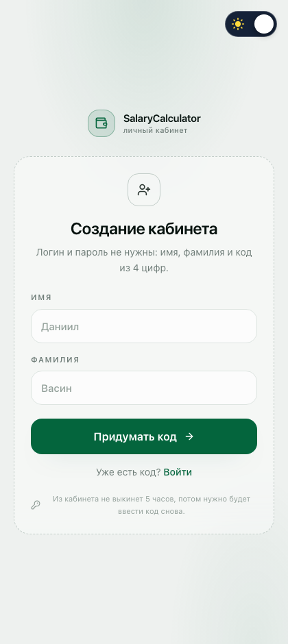
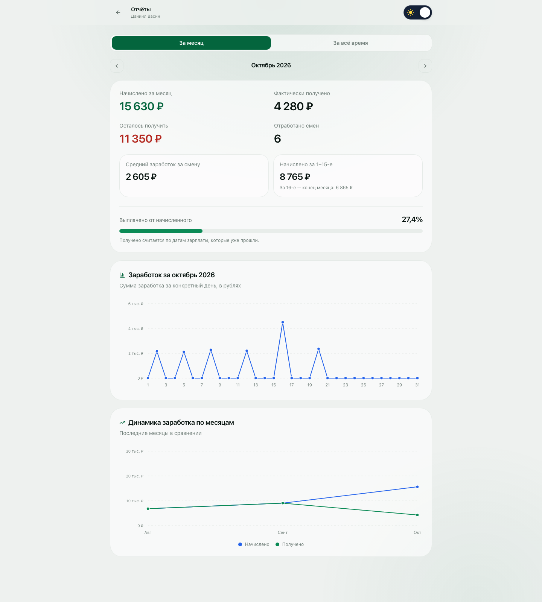
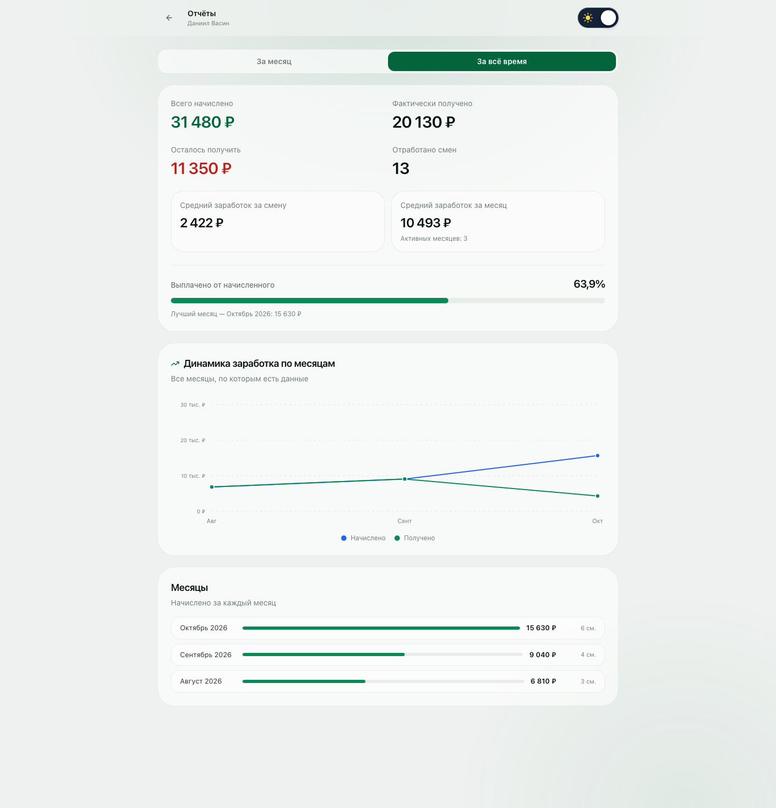

# SalaryCalculator

Личный кабинет сотрудника: график смен, продажи и автоматический расчёт выплат.

Живой продукт для розницы и сменных графиков: сотрудник регистрируется по имени и фамилии,
придумывает код из 4 цифр — и дальше входит только по нему. Указывает процент от продаж и сумму
выхода, настраивает график 2/2 или 3/3 и просто отмечает, на сколько продал за день. Выплату,
отчёты и обратный отсчёт до зарплаты сайт считает сам.

## Формула

~~~text
выплата за день = сумма выхода + процент от продаж × сумма проданного товара
~~~

Пример: выход 2 000 ₽, процент 5%, продажи 50 000 ₽ → 2 000 + 0,05 × 50 000 = 4 500 ₽

## Что уже есть

- **Регистрация первым экраном.** Сайт открывается на /register: имя, фамилия и код из 4 цифр,
  который набирается круглой клавиатурой как в телефонном наборе. Код вводится дважды.
- **Вход по коду.** Повторный визит — /login: назвал себя, ввёл код, попал в кабинет.
- **Сессия живёт 5 часов без активности.** Активность продлевает срок; после пяти часов простоя
  кабинет закрывается и снова просит код. Сессия лежит в localStorage и дублируется в cookie
  с тем же сроком.
- **Быстрая настройка из двух шагов:** процент от продаж + сумма выхода, затем график смен.
- **Умный календарь.** Выбираешь 2/2 или 3/3, отмечаешь рабочие дни в первом цикле —
  календарь продлевает ритм на все месяцы вперёд. Любой день можно переопределить вручную.
- **Ввод продаж по дню.** Клик по дате → сумма продаж → выплата пересчитывается на лету с анимацией.
- **Итоги месяца:** смены, дни с продажами, оборот и выплата.
- **Даты зарплаты и обратный отсчёт.** Дни месяца вводятся с клавиатуры (Enter добавляет, Backspace
  убирает последний), а под шапкой появляется строка «До зарплаты через 4 дня · 20 октября».
- **Отчёты с инфографикой.** Кнопка «Отчёты» открывает сводку и графики за месяц или за всё время:
  начислено, получено, остаток, средний заработок, разбивка на 1–15-е и 16-е — конец месяца.
- **Светлая и тёмная темы.** Переключатель — ползунок как на референсе: солнце слева, луна и звёзды
  справа, бегунок закрывает неактивную иконку. Выбор запоминается, при первом входе подхватывается системная тема.
- **Плавные анимации** на framer-motion: переходы страниц, календаря, модалок и счётчиков.

## Как выглядит

| Вход | Быстрая настройка |
| --- | --- |
|  |  |

| Кабинет — десктоп | Кабинет — мобильный | Ввод продаж |
| --- | --- | --- |
|  |  |  |

Календарь mobile-first: сетка во всю ширину экрана, номер дня, зелёный кружок на «сегодня»,
жёлтая полоска и сумма на днях с продажами. На узких экранах суммы уходят в компактный формат
(`4,5к`), поэтому вёрстка не ломается даже на 320 px.

## Темы

Переключатель сделан тем самым ползунком: слева солнце, справа луна и звёзды, а белый бегунок
закрывает неактивную иконку. Позиция бегунка и прозрачность иконок задаются чистым CSS через
`html[data-theme]`, а инлайн-скрипт в `<head>` выставляет тему до первой отрисовки — поэтому
при загрузке нет мерцания.

| Тёмная | Светлая |
| --- | --- |
|  |  |

Как это устроено:

1. В src/app/globals.css лежат семантические переменные `--sc-*` для двух наборов значений:
   `:root` / `html[data-theme="dark"]` и `html[data-theme="light"]`.
2. Дизайн-токены Tailwind объявлены через `@theme inline` и ссылаются на эти переменные, поэтому
   `bg-ink-850`, `text-mist-500` или `border-ink-700` сами меняют значение при смене темы —
   переписывать компоненты не нужно.
3. Выбор хранится в localStorage (`salarycalc.theme.v1`) и дублируется в cookie `sc_theme`.
4. Если выбора ещё нет, берётся системная тема из `prefers-color-scheme`.

## Вход по коду

Первый экран — регистрация. Имя, фамилия, затем код из 4 цифр на круглой клавиатуре
(цифры с буквенными группами АБВГ / ABC, как в телефонном наборе), и сразу повтор кода.

Клавиатура круглая, как в телефонном наборе: каждая кнопка — цифра и под ней буквенные группы
(АБВГ / ABC, ДЕЖЗ / DEF и так далее). Сверху четыре точки-индикатора, при ошибке они трясутся,
а код стирается. Клавиатура слушает и физическую: цифры, Backspace, Escape.

Как это устроено:

1. Код не хранится в открытом виде: в `employees.pin_hash` лежит SHA-256 от случайной соли
   и самого кода, соль — в `employees.pin_salt`. Без `crypto.subtle` (незащищённый контекст)
   уходит на запасной хеш, чтобы вход не ломался.
2. Сессия — это `employeeId` плюс `lastActivityAt`. Срок жизни 5 часов
   (`SESSION_TTL_MS` в src/lib/session.ts), продлевается на клики, клавиши, скролл и возврат
   во вкладку — но не чаще раза в минуту.
3. Cookie `sc_session` живёт ровно столько же, поэтому серверный прокси закрывает кабинет
   даже до того, как отработает клиентская проверка.
4. Раз в 30 секунд клиент проверяет срок и при простое выкидывает на /login.

> Честно о безопасности: база открыта для anon-ключа, поэтому `pin_hash` читаем из браузера
> и 4 цифры теоретически перебираются. Код защищает от случайного входа, но не от целенаправленного.
> Если пойдут реальные деньги — нужен Supabase Auth и политики на `auth.uid()`.

## Даты зарплаты

В настройках (и на первом шаге быстрой настройки) есть поле `SalaryDaysField`: вводишь день месяца
и жмёшь **Enter**. Занятая запятая, точка с запятой или пробел тоже добавляют дату, **Backspace**
на пустом поле убирает последнюю. Значения хранятся в `employees.salary_days` строкой вида `5,20`.

Логика ближайшей выплаты — в src/lib/salary.ts:

1. Для каждой даты строится число в текущем месяце; если оно уже прошло, берётся следующий месяц.
2. День подрезается под длину месяца: 31-е в феврале превращается в 28-е (или 29-е).
3. Из всех вариантов берётся самый близкий, и считается разница в календарных днях от сегодня.
4. Строка сама обновляется раз в минуту, поэтому переход через полночь подхватывается.

Если даты не заданы, на их месте — подсказка «Даты зарплаты не заданы · Добавить», по клику
открываются настройки.

## Отчёты

Кнопка **Отчёты** в шапке кабинета открывает /reports: сводка и графики за выбранный месяц или за всё время.

| За месяц | За всё время |
| --- | --- |
|  |  |

Что считается (вся логика в src/lib/report.ts):

- **Начислено за месяц** — сумма выплат по всем дням месяца, где внесены продажи.
- **Отработано смен** — количество дней с внесёнными продажами.
- **Средний заработок за смену** — начислено, делённое на число смен.
- **Начислено за 1–15-е** и подпись **«За 16-е — конец месяца»** — разбивка месяца пополам, как в расчётном листке.
- **Фактически получено** — начисления за дни, закрытые прошедшими датами зарплаты. Для прошедших
  месяцев это вся сумма, для текущего — только до последней прошедшей даты, для будущих — ноль.
- **Осталось получить** — начислено минус получено.
- **Выплачено от начисленного** — тот же остаток в процентах плюс полоса прогресса.

Графики нарисованы своим SVG, без сторонних библиотек:

1. **Заработок по дням** — линия по дням месяца с точками и тултипом при наведении.
2. **Динамика по месяцам** — две линии, «Начислено» и «Получено», с легендой.
3. Ось Y сама подбирает круглые деления (0, 2, 4, 6 тыс. ₽), ширина считается через ResizeObserver,
   так что график корректно перестраивается под любой экран.

## Стек

| Слой | Технология | Версия |
| --- | --- | --- |
| Фронтенд | Next.js, App Router | 16.4.2 |
| | React | 19.3.1 |
| | TypeScript | 5.9.3 |
| Стили | Tailwind CSS | 4.3.3 |
| Анимации | framer-motion | 14.3.0 |
| Даты | date-fns (локаль ru) | 4.4.0 |
| Иконки | lucide-react | 1.58.0 |
| Данные | @supabase/supabase-js | 2.118.0 |
| Хостинг | Vercel | — |

Сторонних библиотек для графиков нет: линии рисуются своим SVG (src/components/charts/LineChart.tsx).
`npm audit` показывает 0 уязвимостей. TypeScript держим на 5.9.3, хотя вышел 7.0.2: семёрка —
это новый компилятор на Go, и интеграция с Next.js 16 пока рассчитана на 5.x.

## Запуск локально

~~~bash
npm install
npm run dev
~~~

Открой http://localhost:3000

Без переменных окружения приложение полностью работает на localStorage браузера —
удобно посмотреть интерфейс до подключения Supabase.

## Подключение Supabase

1. Создай проект на https://supabase.com
2. Открой **SQL Editor** и выполни содержимое файла supabase/schema.sql
3. Скопируй из **Settings → API** значения Project URL и anon public key
4. Положи их в .env.local:

~~~bash
NEXT_PUBLIC_SUPABASE_URL=https://ваш-проект.supabase.co
NEXT_PUBLIC_SUPABASE_ANON_KEY=ваш-anon-key
~~~

5. Перезапусти dev-сервер или пересобери проект

Если переменные пустые — приложение автоматически откатывается на localStorage.

### Миграции

Файл supabase/schema.sql можно выполнять повторно: все создания идут с `if not exists`.
Если таблицы уже были созданы более ранней версией схемы, допиши недостающие колонки:

~~~sql
alter table public.employees add column if not exists salary_days text not null default '';
alter table public.employees add column if not exists pin_hash text not null default '';
alter table public.employees add column if not exists pin_salt text not null default '';
~~~

Слой данных (src/lib/db.ts) сам выбрасывает из запроса колонки, которых нет в старой схеме,
и пишет подсказку в консоль. Поэтому приложение не падает на устаревшей базе — просто не сохраняет
эти поля, пока миграция не выполнена.

### Важно про безопасность

Код из 4 цифр защищает от случайного входа, но не заменяет аутентификацию: клиент ходит в Supabase
с anon-ключом и открытыми RLS-политиками (см. конец supabase/schema.sql). Значит `pin_hash`
читается из браузера, а 4 цифры перебираются. Если пойдут реальные выплаты — нужен Supabase Auth
с политиками на `auth.uid()`.

## Деплой на Vercel

~~~bash
npm i -g vercel
vercel login
vercel --prod
~~~

Не забудь добавить NEXT_PUBLIC_SUPABASE_URL и NEXT_PUBLIC_SUPABASE_ANON_KEY
в **Project Settings → Environment Variables** на Vercel и передеплоить.

## Структура

~~~text
src/
  app/
    layout.tsx            корневой layout, тема до первой отрисовки
    globals.css           семантические токены тем + служебные классы
    page.tsx              точка входа: решает, куда отправить пользователя
    register/page.tsx     регистрация: имя, фамилия, код из 4 цифр
    login/page.tsx        вход по имени и коду
    setup/page.tsx        экран быстрой настройки (2 шага)
    dashboard/page.tsx    календарь, продажи, итоги месяца, строка до зарплаты
    reports/page.tsx      отчёты: сводка и графики за месяц и за всё время
    icon.svg              иконка сайта
  components/
    PinPad.tsx            круглая клавиатура для 4-значного кода
    CalendarGrid.tsx      сетка календаря + плитки статистики месяца
    ScheduleEditor.tsx    выбор 2/2 или 3/3, рабочие дни цикла, превью графика
    DayEditor.tsx         ввод суммы продаж и живой расчёт выплаты
    SetupWizard.tsx       визард первичной настройки
    SettingsModal.tsx     настройки выплат, графика и дат зарплаты
    SalaryDaysField.tsx   ввод дат зарплаты с клавиатуры
    SalaryCountdown.tsx   строка «До зарплаты через 4 дня»
    ReportSummary.tsx     карточка сводки отчёта
    charts/LineChart.tsx  SVG-график линий с тултипом и легендой
    ThemeToggle.tsx       ползунок светлой и тёмной темы
    AnimatedNumber.tsx    счётчик с анимацией
    Logo.tsx, ui.tsx      логотип и базовые элементы интерфейса
  hooks/
    useEmployee.ts        загрузка сотрудника, редиректы, простой 5 часов
    useTheme.ts           применение и сохранение темы
    useMediaQuery.ts      адаптивные проверки
    useElementWidth.ts    ширина контейнера для графиков
  lib/
    types.ts              типы Employee, Sale, Session
    db.ts                 слой данных: Supabase или localStorage
    supabase.ts           клиент Supabase из переменных окружения
    session.ts            сессия, срок 5 часов, cookie
    pin.ts                хеширование и проверка 4-значного кода
    schedule.ts           логика циклических графиков
    calendar.ts           построение сетки месяца и итогов
    payout.ts             формула выплаты
    report.ts             расчёты для отчётов
    salary.ts             даты зарплаты и ближайшая выплата
    amount.ts             разбор введённых сумм
    format.ts             форматирование денег и чисел (ru-RU)
    utils.ts              склейка классов
  proxy.ts                серверный редирект по cookie сессии
supabase/schema.sql       схема БД и политики
docs/screenshots/         скриншоты для README
~~~

## Дизайн

Цвета сняты прямо со референса:

| Токен | Значение | Где используется |
| --- | --- | --- |
| ink-950 | #0b0d0d | фон приложения |
| ink-850 | #181a1a | карточки и панели |
| ink-700 | #2b302f | границы |
| brand-500 | #04653d | основная кнопка и заливка смен |
| brand-300 | #6fd9ad | акценты и цифры |
| mist-100 | #f3f7f5 | основной текст |
| mist-500 | #79837f | подписи |

В светлой теме набор значений тот же по смыслу, но другие значения переменных: зелёный для текста
темнее, жёлтая полоска продаж насыщеннее, красный удаления глубже. Меняются только переменные —
компоненты не переписываются.

## Статус

| Что | Где | Состояние |
| --- | --- | --- |
| Код | github.com/DanOrLove/Salary-Calculator | ветка `main`, актуальная версия |
| Прод | salary-calculator-sable.vercel.app | задеплоен, Vercel Authentication снята |
| База | chmraqnagmpwvljuprka.supabase.co | таблицы `employees`, `day_overrides`, `sales` созданы |
| Переменные | Vercel → Production | `NEXT_PUBLIC_SUPABASE_URL`, `NEXT_PUBLIC_SUPABASE_ANON_KEY` |

Что стоит доделать:

1. **Миграция колонок.** Выполни три `alter table` из раздела «Миграции» — сейчас приложение
   работает, но не сохраняет даты зарплаты и код входа.
2. **Автодеплой из GitHub.** Установи [Vercel GitHub App](https://github.com/apps/vercel/installations/new)
   и выбери репозиторий — после этого каждый `git push` будет деплоиться сам.
3. **Настоящая аутентификация**, если проект выйдет за пределы доверенной команды.
