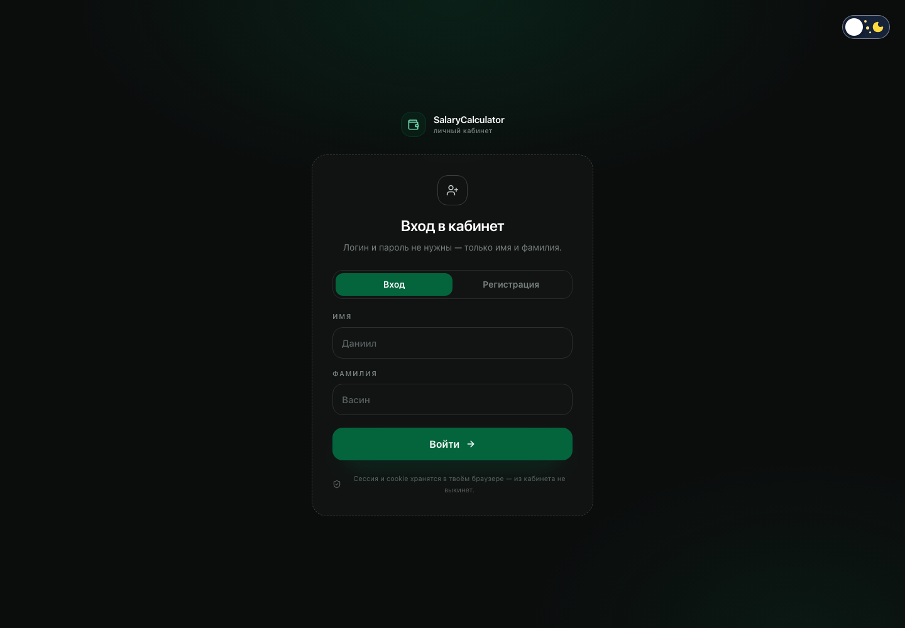
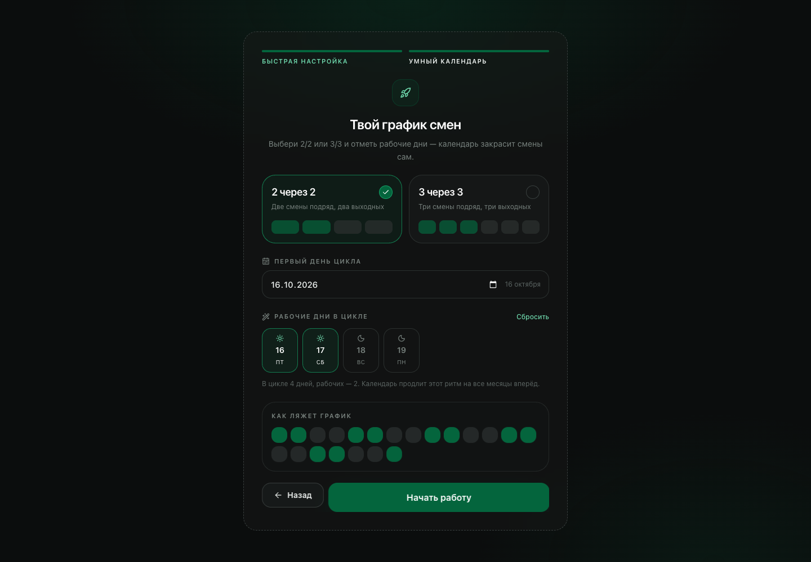
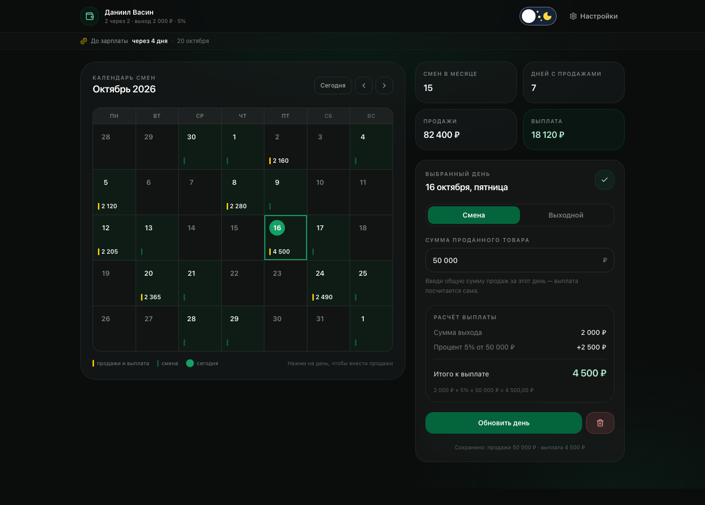
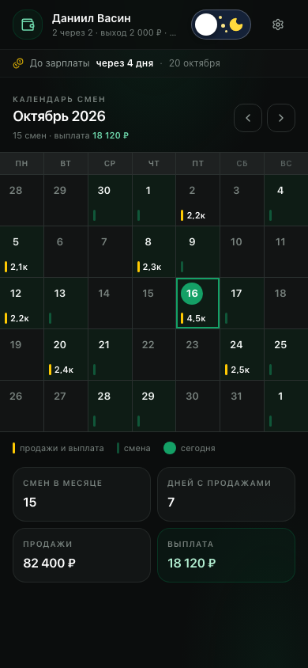
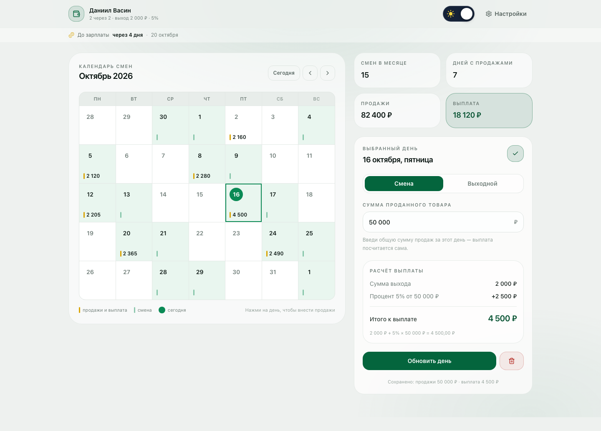
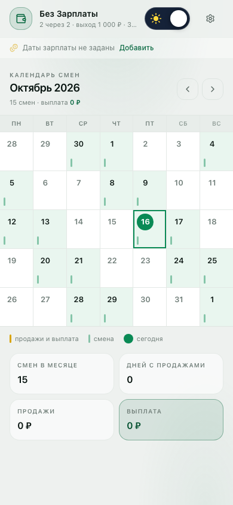

# SalaryCalculator

Личный кабинет сотрудника: график смен, продажи и автоматический расчёт выплат.

Живой продукт для розницы и сменных графиков: сотрудник входит по имени и фамилии (без логина и пароля),
указывает свой процент от продаж и сумму выхода, настраивает график 2/2 или 3/3 — и дальше просто
отмечает, на сколько продал за день. Выплату сайт считает сам.

## Формула

~~~text
выплата за день = сумма выхода + процент от продаж × сумма проданного товара
~~~

Пример: выход 2 000 ₽, процент 5%, продажи 50 000 ₽ → 2 000 + 0,05 × 50 000 = 4 500 ₽

## Что уже есть

- **Вход и регистрация по имени и фамилии.** Пароля нет вообще: имя и фамилия — это и есть аккаунт.
- **Постоянная сессия.** Сессия лежит в localStorage и дублируется в cookie (1 год), поэтому из кабинета не выкидывает.
- **Быстрая настройка из двух шагов:** процент от продаж + сумма выхода, затем график смен.
- **Умный календарь.** Выбираешь 2/2 или 3/3, отмечаешь рабочие дни в первом цикле —
  календарь продлевает ритм на все месяцы вперёд. Любой день можно переопределить вручную.
- **Ввод продаж по дню.** Клик по дате → сумма продаж → выплата пересчитывается на лету с анимацией.
- **Итоги месяца:** смены, дни с продажами, оборот и выплата.
- **Даты зарплаты и обратный отсчёт.** Дни месяца вводятся с клавиатуры (Enter добавляет, Backspace
  убирает последний), а под шапкой появляется строка «До зарплаты через 4 дня · 20 октября».
- **Светлая и тёмная темы.** Переключатель — ползунок как на референсе: солнце слева, луна и звёзды
  справа, бегунок закрывает неактивную иконку. Выбор запоминается, при первом входе подхватывается системная тема.
- **Плавные анимации** на framer-motion: переходы страниц, календаря, модалок и счётчиков.

## Как выглядит

| Вход | Быстрая настройка |
| --- | --- |
|  |  |

| Кабинет — десктоп | Кабинет — мобильный | Ввод продаж |
| --- | --- | --- |
|  |  |  |

Календарь mobile-first: сетка во всю ширину экрана, номер дня, зелёный кружок на «сегодня»,
жёлтая полоска и сумма на днях с продажами. На узких экранах суммы уходят в компактный формат
(`4,5к`), поэтому вёрстка не ломается даже на 320 px.

## Темы

Переключатель сделан тем самым ползунком: слева солнце, справа луна и звёзды, а белый бегунок
закрывает неактивную иконку. Позиция бегунка и прозрачность иконок задаются чистым CSS через
`html[data-theme]`, а инлайн-скрипт в `<head>` выставляет тему до первой отрисовки — поэтому
при загрузке нет мерцания.

| Тёмная | Светлая |
| --- | --- |
|  |  |

Как это устроено:

1. В src/app/globals.css лежат семантические переменные `--sc-*` для двух наборов значений:
   `:root` / `html[data-theme="dark"]` и `html[data-theme="light"]`.
2. Дизайн-токены Tailwind объявлены через `@theme inline` и ссылаются на эти переменные, поэтому
   `bg-ink-850`, `text-mist-500` или `border-ink-700` сами меняют значение при смене темы —
   переписывать компоненты не нужно.
3. Выбор хранится в localStorage (`salarycalc.theme.v1`) и дублируется в cookie `sc_theme`.
4. Если выбора ещё нет, берётся системная тема из `prefers-color-scheme`.

| Светлая | Тёмная |
| --- | --- |
|  |  |

## Даты зарплаты

В настройках (и на первом шаге быстрой настройки) есть поле `SalaryDaysField`: вводишь день месяца
и жмёшь **Enter**. Занятая запятая, точка с запятой или пробел тоже добавляют дату, **Backspace**
на пустом поле убирает последнюю. Значения хранятся в `employees.salary_days` строкой вида `5,20`.

Логика ближайшей выплаты — в src/lib/salary.ts:

1. Для каждой даты строится число в текущем месяце; если оно уже прошло, берётся следующий месяц.
2. День подрезается под длину месяца: 31-е в феврале превращается в 28-е (или 29-е).
3. Из всех вариантов берётся самый близкий, и считается разница в календарных днях от сегодня.
4. Строка сама обновляется раз в минуту, поэтому переход через полночь подхватывается.

Если даты не заданы, на их месте — подсказка «Даты зарплаты не заданы · Добавить», по клику
открываются настройки.

## Стек

- Next.js 16 (App Router) + React 19 + TypeScript
- Tailwind CSS v4 — дизайн-токены вынесены в src/app/globals.css
- framer-motion — переходы страниц, календаря, модалок и счётчиков
- date-fns — работа с датами и русская локаль
- Supabase — база данных (Postgres)
- Vercel — хостинг

## Запуск локально

~~~bash
npm install
npm run dev
~~~

Открой http://localhost:3000

Без переменных окружения приложение полностью работает на localStorage браузера —
удобно посмотреть интерфейс до подключения Supabase.

## Подключение Supabase

1. Создай проект на https://supabase.com
2. Открой **SQL Editor** и выполни содержимое файла supabase/schema.sql
3. Скопируй из **Settings → API** значения Project URL и anon public key
4. Положи их в .env.local:

~~~bash
NEXT_PUBLIC_SUPABASE_URL=https://ваш-проект.supabase.co
NEXT_PUBLIC_SUPABASE_ANON_KEY=ваш-anon-key
~~~

5. Перезапусти dev-сервер или пересобери проект

Если переменные пустые — приложение автоматически откатывается на localStorage.

### Важно про безопасность

Вход сделан без пароля, поэтому клиент ходит в Supabase с anon-ключом и открытыми RLS-политиками
(см. конец supabase/schema.sql). Это осознанный компромисс ради входа «просто по имени».
Если проект вырастет — стоит добавить хотя бы PIN или Supabase Auth и заменить политики на auth.uid().

## Деплой на Vercel

~~~bash
npm i -g vercel
vercel login
vercel --prod
~~~

Не забудь добавить NEXT_PUBLIC_SUPABASE_URL и NEXT_PUBLIC_SUPABASE_ANON_KEY
в **Project Settings → Environment Variables** на Vercel и передеплоить.

## Структура

~~~text
src/
  app/
    layout.tsx          корневой layout, тема, шрифты
    globals.css         дизайн-токены Tailwind v4 (цвета со скриншота)
    page.tsx            точка входа: решает, куда отправить пользователя
    login/page.tsx      вход и регистрация по имени и фамилии
    setup/page.tsx      экран быстрой настройки (2 шага)
    dashboard/page.tsx  календарь, продажи, итоги месяца
  components/
    CalendarGrid.tsx    календарь смен + плитки статистики месяца
    ScheduleEditor.tsx  выбор 2/2 или 3/3, рабочие дни цикла, превью графика
    DayEditor.tsx       ввод суммы продаж и живой расчёт выплаты
    SetupWizard.tsx     визард первичной настройки
    SettingsModal.tsx   настройки выплат и графика
    ui.tsx              Button, TextField, Modal, Segmented, Badge и прочее
  hooks/useEmployee.ts  загрузка сотрудника, редиректы, выход
  lib/
    db.ts               единый слой данных (Supabase или localStorage)
    session.ts          сессия в localStorage + cookie
    schedule.ts         логика циклических графиков
    calendar.ts         построение сетки месяца
    payout.ts           формула выплаты
    supabase.ts         клиент Supabase из env
    format.ts           форматирование денег и чисел (ru-RU)
  middleware.ts         серверный редирект по cookie
supabase/schema.sql     схема БД
~~~

## Дизайн

Цвета сняты прямо со референса:

| Токен | Значение | Где используется |
| --- | --- | --- |
| ink-950 | #0b0d0d | фон приложения |
| ink-850 | #181a1a | карточки и панели |
| ink-700 | #2b302f | границы |
| brand-500 | #04653d | основная кнопка и заливка смен |
| brand-300 | #6fd9ad | акценты и цифры |
| mist-100 | #f3f7f5 | основной текст |
| mist-500 | #79837f | подписи |
